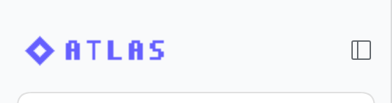

# 侧栏品牌

[English](README.md)

隐藏侧栏 Logo 和品牌文字，或用一张本地图片替换。
侧栏开关仍可使用。

在 DSH 0.2.2-rc.5 中使用。先在本目录运行 `pnpm install` 构建，再从 **插件 → 添加插件** 选择本目录。
从 **插件 → 侧栏品牌** 选择不超过 1 MiB 的 PNG、JPEG、WebP、SVG、GIF 或 AVIF。
展开时适合用横版图片，折叠时同一张图会等比缩进方形区域，悬停仍显示原生展开图标。

移除图片会隐藏品牌，保留原生展开按钮。停用插件会恢复原 Logo 和文字。
图片保存在当前浏览器对应的 DSH 地址下，重新启用插件时可以继续使用。

[开发与验证](docs/README.md)

## 实拍截图

展开的侧栏显示上传的演示标识，原生侧栏按钮仍可见。

[深色主题](docs/assets/screenshots/main-dark.png)
